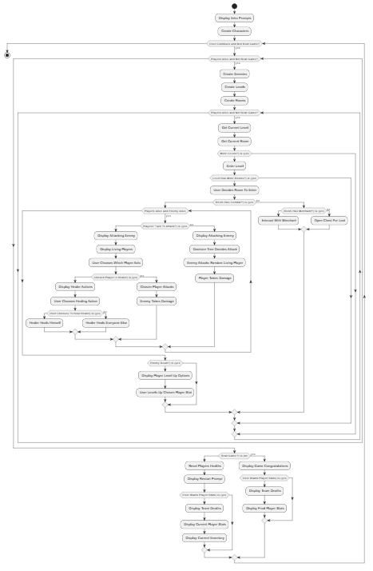
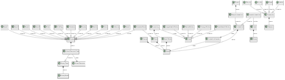
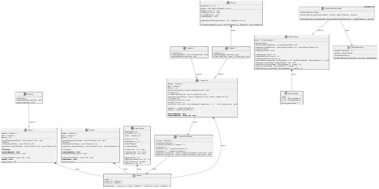
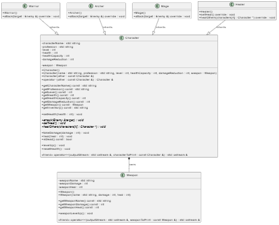
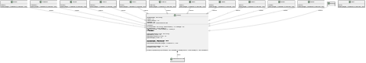
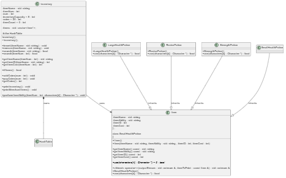
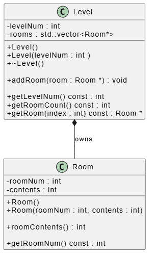

# Software Design Document

## 1. Introduction

- **Purpose**:
  - The purpose of this document will be to showcase the design of my Text-Based Dungeon Crawler Game that I programmed using C++. 

- **Game Description**: 
  - This program produces a text-based video game to be played within the terminal.
  - Provides the user with multiple prompts to guide them through the game. The game is currently very straight forward. 
  - The user plays as a team of four lost travelers stuck in a cave. 
  - The user can control combat sequences, defeat enemies, level up different character stats, and find or buy and then use different inventory items to progress deeper into the dungeon.
  - Each time the characters die they are reset to the beginning of the game to try again.
  - Once every room in every level has been cleared, the game is won and the program terminates.

---

## 2. System Overview

- **System Description**: 
  - The system currently incorporates four templated data structures (Unordered Linked List, Stack, Queue, and Binary Tree), a Hash Table, a Graph, and a multitude of other classes to organize functions.

- **Design Goals**: 
  - To produce a working program that brings at least a little joy to the user.

- **Architecture Summary**: 
  - This is an Event-Driven and Serverless program.

- **System Context Diagram**:

---

## 3. Architectural Design

### Data Structure Classes
- **System Architecture Diagram**:
  - 
  
- **Component Breakdown**:
  - The Linked List class applies a Linked List Iterator in order to move through the list after creation.
  - Levels Linked List implements the Linked List class to store Level objects that hold Room objects.
  - Enemies Stack implements the Stack class to store Enemy objects to be used for combat.
  - Queue is used to control the turn sequence of combat between the team of players and the enemy.
  - Attack Decision Tree inherits the Binary Tree class with type AttackDecision to choose an attack based on health percentage.
  - Hash Table hashes an item's id and stores it in the table. Duplicate items are appended to a linked list at that index.
  - Graph pulls vertices and adjacent vertices from a text file and creates a vector of Graph Linked Lists
  - Graph Linked List implements the Linked List class to store adjacent vertices
  - The Linked List class, Stack class, and Queue class are all structured with the Node class.
  - The Binary Tree class is structured with the Binary Node class.

### Character Classes
- **System Architecture Diagram**:
  - 

- **Component Breakdown**:
  - The Character class owns the Weapon class and provides all necessary functions for implementation by its child classes.
  - Character has four child classes (Warrior, Mage, Archer, and Healer) which inherit these functions.
  - All four override the constructor function to have unique values.
  - Warrior, Mage, and Archer override Character's attack function.
  - Healer overrides Character's selfHeal and healOthers functions.

### Enemy Classes
- **System Architecture Diagram**:
  - 

- **Component Breakdown**:
  - The Enemy class provides all necessary functions for implementation by its child classes.
  - Enemy has twelve child classes that inherit these functions.
  - These twelve classes are Mimic, Wolf, Skeleton, Spider, Goblin, Scion, Inferius, Boss1, Boss2, Boss3, Boss4, and Boss5.
  - All twelve override the constructor and attack function to have unique values.
  - The Enemy class owns an Attack Decision Tree
  - Boss classes may later have access to the Inventory class.

### Inventory Classes
- **System Architecture Diagram**:
  - 
  
- **Component Breakdown**:
  - The Inventory class owns the Hash Table class and stores a vector of all Item class objects
  - Provides all necessary functions for insertion and retrieval of items in hash table
  - Controls currency and sales using coins
  - Item class provides all necessary functions for creation, display, and ability use of items
  - There are four Items classes (SmallHealthPotion, LargeHealthPotion, RevivePotion, and StrengthPotion) that inherit these functions and override the use function.

### Level Classes
- **System Architecture Diagram**:
  - 
  
- **Component Breakdown**:
  - The Level class provides all necessary functions for creation of levels and insertion of rooms
  - The Room class provides all necessary functions for creation of rooms 

---

## 4. Detailed Design

### Main Function
- **Responsibilities**: 
  - To control the flow of data
  - Characters and Inventory are initialized before the while loops so that stats can be kept between deaths
  - Every time the players die, the Enemies Stack, Levels Linked List, and Linked List Iterator go out of scope in order to reset the players back at the beginning

- **Interfaces**: 
  - Inputs: User chooses to continue or quit between deaths
  - Outputs: Displays choice
  - Error Handling: Anything but 'q' will continue the game

- **Data Structure**: 
  - Initializes Characters and then puts them into an array
  - Initializes Inventory
  - Initializes necessary game variables
  - Initialzes Enemy Stack and calls createEnemies()
  - Initializes Levels Linked List and calls createLevels()
  - Initializes Linked List Iterator

- **Algorithms/Logic**: 
  - Nested while loops with two if else statements between them
  - Calls enterNextRoom() and uses its return value to call combat(), merchant(), or chest()
  - Calls resetPlayers() if the game has not been beaten yet or beatGameMsg() if it has

### Intro Text Function
- **Responsibilities**: 
  - Displays prompts to the user to give them a little lore of the players and the game

- **Interfaces**:
  - Inputs: User must press "enter" to continue through the prompts
  - Outputs: Prompts containing lore into the origins of the four travelers
  - Error Handling: resestStream() is called to prevent crashing

### Create Enemies Function
- **Responsibilities**: 
  - Creates a unique order of Enemies objects and pushes their pointers to a Stack

- **Data Structures**: 
  - Custom Stack to store enemies

- **Algorithms/Logic**: 
  - Enum of enemies for readabilty
  - Array for the order of the enums
  - For loop with a switch to create enemies

### Create Levels Function
- **Responsibilities**: 
  - Create the levels and assigns rooms to them
  - Assigns rooms with a int of combat, merchant or chest

- **Data Structures**: 
  - Custom Ordered Linked List to store levels

- **Algorithms/Logic**: 
  - Array of rooms per level
  - 2D vector to store roomContents int values
  - Nested for loops to initialize levels and then rooms within

### Enter Next Room Function
- **Responsibilities**: 
  - To increment levels and move through rooms graph
  - To return the current room's contents

- **Interfaces**:
  - Input: When presenting the user with two possible rooms the user will enter left or right
  - Outputs: Displays the current level when a new level has been reached. Displays prompts based on room contents
  - Error Handling: User must enter left or right. resetStream() to prevent crashing

- **Data Structures**: 
  - Graph Linked List to get adjacent vertices from graph vertex
  - Linked List Iterator to Graph Linked List
  - Linked List Iterator to progress through levels

- **Algorithms/Logic**: 
  - Vector to be loaded with adjacent room choices from graph iterator
  - srand() seeded with time to decide which room is left or right

### Find Room Funtion
- **Responsibilities**: 
  - Iterates through levels and rooms to find a room number's object
  - Returns the found room object

- **Data Structures**: 
  - Uses the linked list iterator to move through levels

- **Algorithms/Logic**: 
  - Uses an if statement within a for loop for the rooms within a while loop for the levels

### Combat Function
- **Responsibilities**: 
  - Implements a Queue in order to decide the order of combat between the enemy or the players

- **Data Structures**: 
  - Custom Queue to control combat sequence

- **Algorithms/Logic**: 
  - While loop to make sure both parties are still alive
  - If else statement to carry out Queue

### Enemy Attack Function
- **Responsibilities**: 
  - Enemy chooses random living player and attacks
  - Displays attack message

- **Interfaces**:
  - Outputs: Displays enemy's attack message and targeted player's new health or death

- **Data Structures**: 
  - Accesses top of Enemy Stack
  - Accesses characters array

- **Algorithms/Logic**: 
  - Vector to contain living players
  - Two for loops and srand() seed with current time to randomize enemy's target

### Player Attack Function
- **Responsibilities**: 
  - User chooses which character attacks the enemy or chooses to use an inventory item
  - Chosen character deals damage to enemy or chosen item performs abilty

- **Interfaces**:
  - Inputs: Numbers 1-4 and potential 5
  - Outputs: Displays player's attack message and enemy's new health or death. On enemy death displays level up player stats
  - Error Handling: Can only choose a living player to attack or choose between items held. Can only choose numbers given

- **Data Structures**: 
  - Accesses top of Enemy Stack
  - Accesses characters array
  - Accesses inventory hash table

- **Algorithms/Logic**: 
  - Vector to contain living players
  - Input validation for user to choose what player attacks or if healer heals
  - Input validation for user to choose what item to use
  - If enemy dies, input validation for user to choose what player levels-up and what stat increases

### Merchant Funtion
- **Responsibilities**: 
  - Walks the user through prompts to interact with the Merchant
  - Provides the user with an npc to trade with
  - or a potential enemy

- **Interfaces**:
  - Inputs: strings from the user to move through merchant prompts. Numbers 1-3 as of current item count
  - Output: provides a list of the merchant's wares
  - Error Handling: Can only enter a valid string or choose a valid item. User must also have enough coins to purchsae item

- **Data Structures**: 
  - If the user tries to steal from the merchant he is then added to the enemies stack

- **Algorithms/Logic**: 
  - if statements to move through merchant prompts
  - while loops to control items sales
  - switch to add purchased items to invertory's hash table

### Chest Funtion
- **Responsibilities**: 
  - Award players with an inventory item or coins

- **Interfaces**:
  - Outputs: Displays the awarded item or coins to the terminal

- **Data Structures**: 
  - Inserts inventory item into inventory's hash table

- **Algorithms/Logic**: 
  - Uses srand() seeded with the current time to provide a truly random number

### Reset Players Function
- **Responsibilities**: 
  - Revives players' health and optionally calls displayCharacterStats()

- **Interfaces**:
  - Inputs: User can choose whether to quit or continue and whether to display character stats
  - Outputs: Displays death prompt and calls displayCharacterStats()
  - Error Handling: Only 'y' will print the stats. Anything but 'q' will continue the game. 

### Beat Game Message Function
- **Responsibilities**: 
  - Displays a congratulatory message to the user as they beat the game

- **Interfaces**:
  - Inputs: Prompts the user to press "enter" after congratulatory message
  - Outputs: Displays congrats and calls displayCharactersStats()
  - Error Handling: resestStream() is called to prevent crashing

### Display Character Stats Funtion
- **Responsibilities**: 
  - Displays team deaths count, character statistics, coin count, and inventory to the terminal

- **Data Structures**: 
  - Accesses characters array to display stats
  - Access inventory to print inventory

---

## 5. Testing Strategy

- **Unit Testing**: 
  - Tested most functions individually to confirm functionality

- **Integration Testing**: 
  - Constant IO testings to make sure each new addition of code works as it should

- **End-to-End Testing**: 
  - I have played through the game in its entirety, and everything works as it should.

- **Quality Metrics**: 
  - Everything currently implemented works as it should.
  - I used the crtdbg.h library to observe memory leaks.
  - To produce the current best looking interface the user will need to press "enter" twice for some of the prompts

---